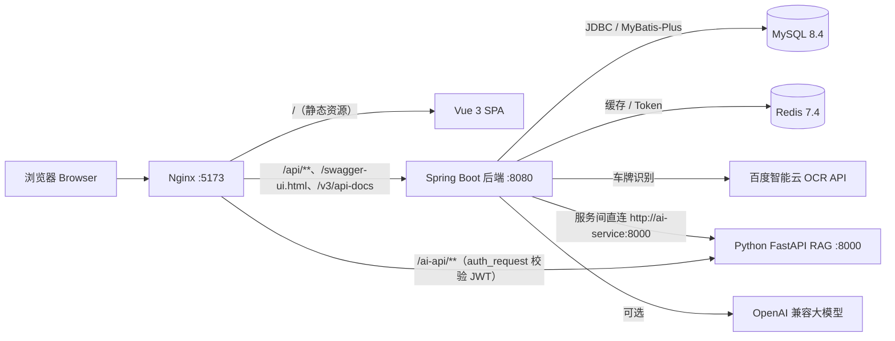
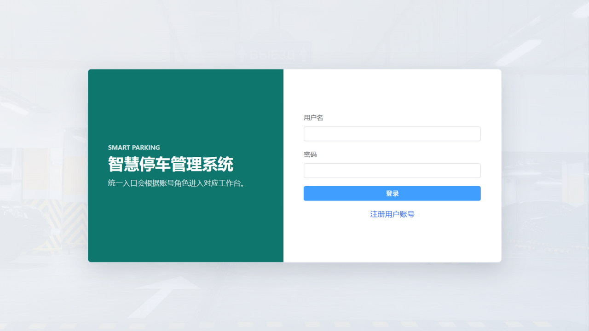
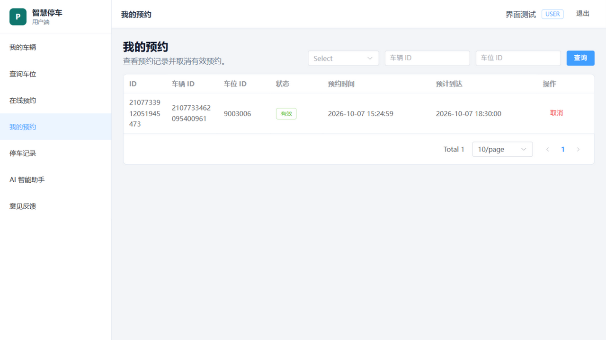
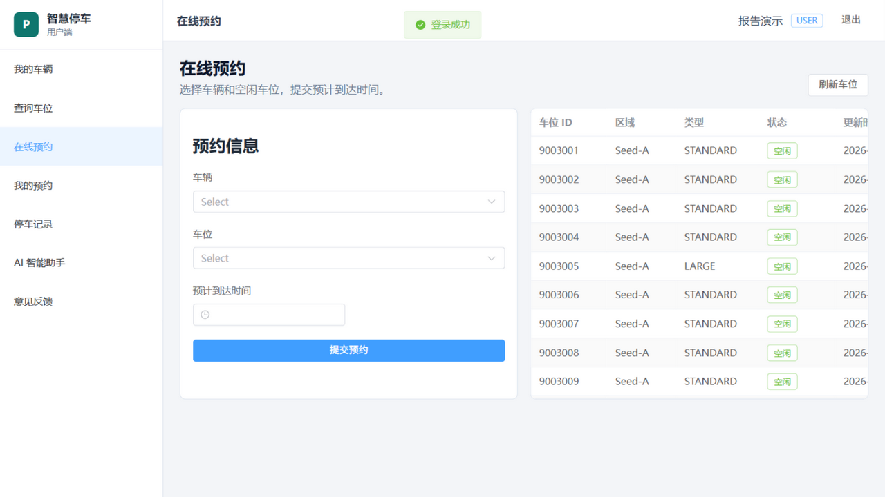
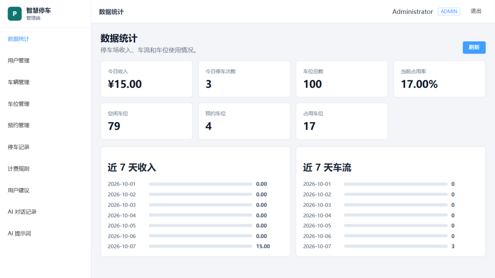
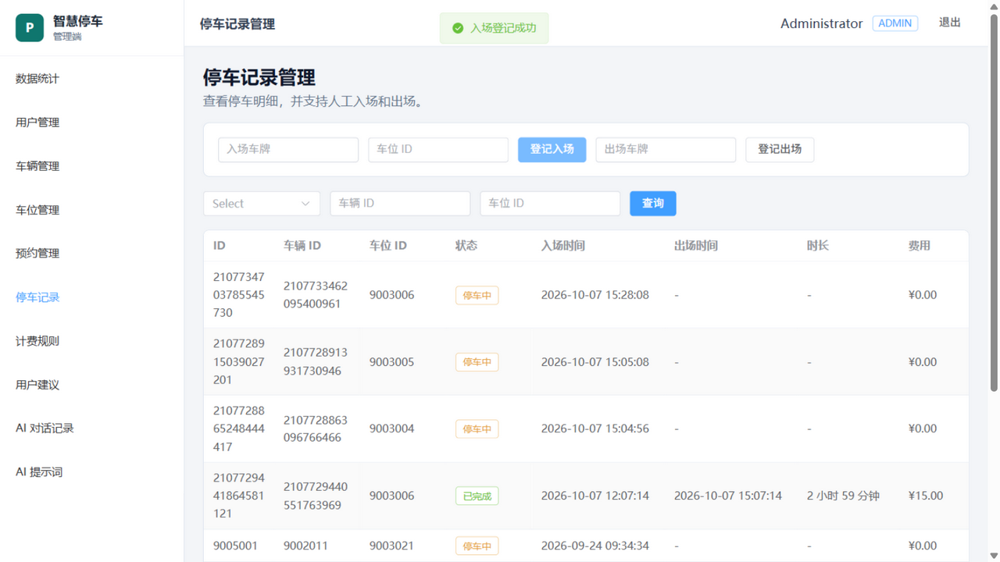
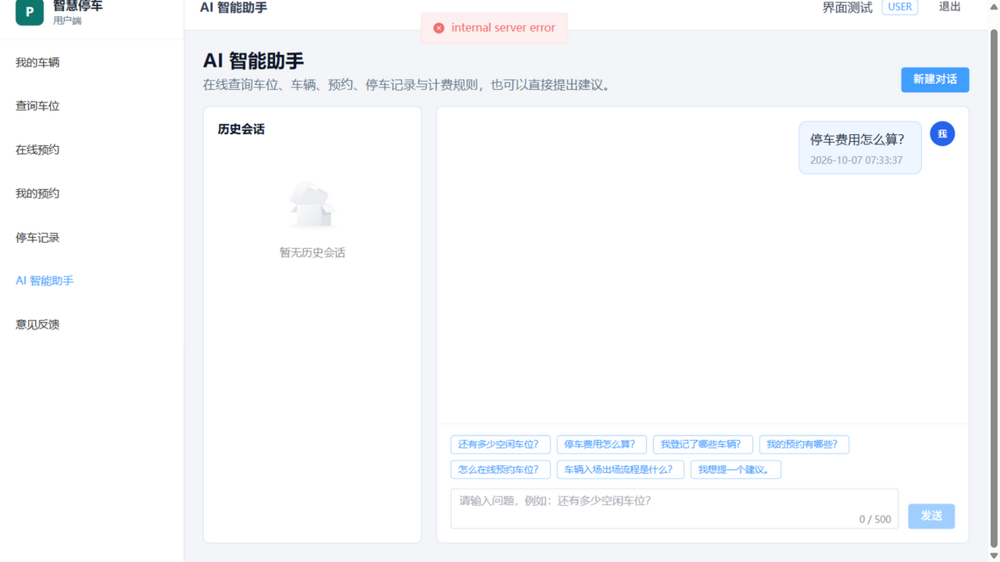

# 智慧停车场管理系统（Smart Parking Management System）

面向中小型停车场运营场景的前后端分离管理系统，覆盖 **用户认证、车辆管理、车位管理、在线预约、人工/OCR 自动出入场、停车计费、数据统计与 AI 智能问答** 的完整业务闭环。

后端采用 Spring Boot 3 + MyBatis-Plus + MySQL + Redis，前端采用 Vue 3 + TypeScript + Element Plus，并附带一个独立的 Python FastAPI RAG 知识问答服务，全部服务通过 Docker Compose 一键编排。


---

## 目录

- [功能特性](#功能特性)
- [技术栈](#技术栈)
- [系统架构](#系统架构)
- [目录结构](#目录结构)
- [快速开始（Docker Compose）](#快速开始docker-compose)
- [本地开发](#本地开发)
- [关键环境变量](#关键环境变量)
- [核心实现说明](#核心实现说明)
- [数据库设计](#数据库设计)
- [接口文档与测试](#接口文档与测试)
- [页面预览](#页面预览)
- [项目文档](#项目文档)

---

## 功能特性

### 用户端（`ROLE_USER`）

| 模块 | 说明 |
| --- | --- |
| 账号 | 注册、登录、JWT 刷新与登出、修改密码、修改个人资料 |
| 车辆 | 新增 / 修改 / 删除 / 查询自己的车辆，车牌号全局唯一 |
| 车位 | 按区域、状态查询车位与实时状态 |
| 预约 | 在线预约车位、取消预约、查看个人预约记录；同一用户仅允许一个 `ACTIVE` 预约 |
| 停车记录 | 查看个人停车记录与费用明细 |
| AI 助手 | 自然语言查询车位、计费、预约等问题，支持多轮会话与推荐问题 |
| 意见反馈 | 提交建议、查看处理进度与管理员回复 |

### 管理端（`ROLE_ADMIN`）

| 模块 | 说明 |
| --- | --- |
| 用户 / 车辆 | 分页查询与用户状态管理，可查看全部车辆 |
| 车位 | 车位 CRUD、分页与按区域/状态筛选、乐观锁并发控制 |
| 预约 | 查看全部预约、预约超时自动过期释放 |
| 出入场 | 人工登记入场 / 出场，自动计算停车费用并释放车位 |
| 计费 | 计费规则新增、修改、启用与分页查询 |
| OCR | 百度车牌识别图片上传、自动入场、自动出场、识别日志查询 |
| 统计 | 今日收入、停车次数、车位占用率、7/30 天收入与车流量趋势 |
| AI 审计 | AI 会话与消息审计、提示词模板管理、用户建议处理与回复 |

### 核心亮点

- **并发安全**：车位状态使用 MyBatis-Plus 乐观锁（`version` 字段），事务内完成「校验 → 锁定 → 落库」，防止重复预约与超卖。
- **缓存加速**：车位实时状态、Dashboard 统计（5 分钟）、JWT Token 版本等写入 Redis；数据库始终是最终事实来源。
- **RBAC 权限**：所有接口通过 `@PreAuthorize` + Spring Security 方法级鉴权，用户只能访问自己的资源。
- **安全加固**：BCrypt 密码、refresh token 轮换、登录失败限流（5 次锁定 15 分钟）、参数校验、AI 提示词防泄漏。
- **可扩展 OCR**：`PlateRecognitionService` 策略接口，默认接入百度智能云车牌识别，预留 PaddleOCR / 阿里云实现位。
- **三引擎 AI**：内置规则引擎（默认）→ OpenAI 兼容大模型 → Python RAG 服务，失败自动降级，接口始终可用。
- **知识库问答**：Python 服务使用纯 Python BM25 词法检索 + 可选 LLM 生成，实时业务数据优先于静态知识，无外部依赖也能离线运行。

---

## 技术栈

| 层次 | 技术 |
| --- | --- |
| 后端 | Java 17、Spring Boot 3.3、Spring Security 6、JWT（jjwt 0.12）、MyBatis-Plus 3.5、MapStruct、Springdoc OpenAPI（Swagger UI）、Maven |
| 数据库 / 缓存 | MySQL 8.4（InnoDB、utf8mb4）、Redis 7.4 |
| 前端 | Vue 3.5、TypeScript 5.7、Vite 6、Pinia、Vue Router 4、Axios、Element Plus |
| AI 服务 | Python 3.11、FastAPI、Uvicorn、httpx、BM25 词法检索、可选 OpenAI 兼容接口 |
| 部署 | Docker、Docker Compose、Nginx（静态资源 + API / AI 网关） |
| 测试 | JUnit 5 + Mockito + MockMvc、Pytest |

---

## 系统架构



请求链路：

1. 浏览器访问 Nginx（前端容器），静态资源由 Nginx 托管；
2. `/api/**` 反向代理到后端，后端完成 JWT 认证与 RBAC 鉴权后处理业务；
3. `/ai-api/**` 经 Nginx `auth_request` 复用后端 `/api/v1/users/me` 校验 JWT 后转发到 Python 服务；
4. 后端调用 Python RAG 服务走 Docker 内网 `http://ai-service:8000`，不经过 Nginx；OCR 走百度智能云 API。

---

## 目录结构

```text
smart-parking/
├── backend/                          # Spring Boot 后端
│   ├── src/main/java/com/smartparking/
│   │   ├── security/                 # JWT 过滤器、SecurityConfig、登录限流
│   │   ├── user/                     # 用户认证与资料
│   │   ├── vehicle/                  # 车辆管理
│   │   ├── parking/                  # 车位管理（乐观锁 + Redis 缓存）
│   │   ├── reservation/              # 在线预约与超时释放定时任务
│   │   ├── record/                   # 停车记录（人工出入场）
│   │   ├── fee/                      # 计费规则与 FeeCalculatorService
│   │   ├── recognition/              # 百度 OCR 车牌识别（策略模式）
│   │   ├── dashboard/                # 统计接口（Redis 缓存 5 分钟）
│   │   ├── ai/                       # AI 问答、建议反馈、提示词模板
│   │   ├── common/ config/           # 统一响应、异常、配置
│   │   └── SmartParkingApplication.java
│   ├── src/main/resources/
│   │   ├── application.yml           # 应用配置（全部可通过环境变量覆盖）
│   │   └── db/sql/                   # 建表与迁移脚本（MySQL 容器首次启动自动执行）
│   ├── src/test/java/                # 单元测试（Service + Controller）
│   ├── Dockerfile                    # 多阶段构建：容器内完成 Maven 编译
│   └── Dockerfile.build              # 可选：仓库根多模块构建
├── frontend/                         # Vue 3 前端
│   ├── src/
│   │   ├── api/                      # Axios 封装与业务 API 模块
│   │   ├── router/ stores/ utils/    # 路由守卫、Pinia、工具
│   │   └── views/                    # 页面（auth / user / admin / layouts）
│   ├── nginx.conf                    # 静态资源 + API/AI 反向代理配置
│   └── Dockerfile
├── ai-service/                       # Python FastAPI RAG 知识问答服务
│   ├── app/                          # main / retrieval / llm / prompts / config
│   ├── data/knowledge/               # Markdown 知识库（预约、计费、服务）
│   ├── tests/                        # Pytest 接口与检索测试
│   └── Dockerfile
├── docs/                             # 架构、数据库、API、开发计划、部署、审计文档
├── sql/init-data.sql                 # 测试种子数据（可选导入）
├── gui-test-screenshots/             # 前后端联调页面截图
├── docker-compose.yml                # 全栈编排（MySQL / Redis / 后端 / AI / 前端）
├── .env.example                      # 环境变量模板
└── README.md
```

---

## 快速开始（Docker Compose）

### 1. 前置要求

- Docker 24+ 与 Docker Compose v2
- 无需本机安装 JDK / Maven / Node：后端与前端镜像均采用多阶段构建，**编译在容器内完成**

### 2. 配置环境变量

```bash
cp .env.example .env
```

至少修改：

| 变量 | 说明 |
| --- | --- |
| `JWT_SECRET` | **必填**，至少 32 字符强随机串（未设置时 compose 会直接启动失败），生成：`openssl rand -base64 48` |
| `MYSQL_ROOT_PASSWORD` | 数据库 root 密码 |
| `BAIDU_OCR_API_KEY` / `BAIDU_OCR_SECRET_KEY` | 百度 OCR 密钥，不配置时 OCR 入场/出场接口返回业务错误，其余功能不受影响 |

### 3. 启动全栈

```bash
# 启动全部服务（含前端，需 --profile frontend）
docker compose --profile frontend up --build -d
```

首次启动会自动创建 MySQL 数据卷并执行 `backend/src/main/resources/db/sql/*.sql` 建表脚本（含默认计费规则）。

查看状态与日志：

```bash
docker compose --profile frontend ps
docker compose logs -f backend
```

### 4. 访问地址

| 功能 | 地址 |
| --- | --- |
| 前端页面 | http://localhost:5173 |
| 后端 API | http://localhost:8080 |
| Swagger UI | http://localhost:8080/swagger-ui.html |
| OpenAPI JSON | http://localhost:8080/v3/api-docs |
| AI 服务健康检查 | http://localhost:8000/health（仅绑定宿主机回环地址） |
| MySQL / Redis | `localhost:3306` / `localhost:6379` |

### 5. 初始化账号与测试数据（可选）

首次部署后数据库为空，可导入开发管理员：

```bash
docker exec -i smart-parking-mysql mysql -uroot -proot smart_parking < docs/dev-admin.sql
```

默认管理员：`admin / Password@123`（仅用于开发环境，请勿用于生产）。

如需导入完整演示数据（10 用户 / 30 车辆 / 100 车位 / 20 预约 / 50 停车记录）：

```bash
docker exec -i smart-parking-mysql mysql -uroot -proot smart_parking < sql/init-data.sql
```

种子用户密码统一为 `Password@123`；脚本使用固定 ID 段，可重复执行。

### 6. 停止与清理

```bash
docker compose --profile frontend down        # 停止但保留数据卷
docker compose --profile frontend down -v     # 停止并删除 MySQL / Redis 数据
```

> 后端镜像默认直接在容器内编译源码。如需改用基于仓库根 `pom.xml` 的 `backend/Dockerfile.build` 构建，可修改 `docker-compose.yml` 中 backend 的 `dockerfile` 字段。

---

## 本地开发

依赖：JDK 17、Maven 3.9+、Node 20+、Python 3.11，以及 Docker（承载 MySQL / Redis）。

```bash
# 1) 只启动 MySQL 与 Redis
docker compose up -d mysql redis

# 2) 后端（默认连接 localhost:3306 / localhost:6379）
cd backend
mvn spring-boot:run

# 3) 前端（Vite 开发服务器，/api 代理到 localhost:8080）
cd frontend
npm install
npm run dev

# 4) AI 服务（可选，后端 AI_PROVIDER=python 时调用）
cd ai-service
python3 -m venv .venv
.venv/bin/pip install -r requirements.txt
.venv/bin/uvicorn app.main:app --host 0.0.0.0 --port 8000
```

> 宿主机直接运行后端时，需将 `AI_PYTHON_BASE_URL` 设为 `http://localhost:8000`（默认 `http://ai-service:8000` 仅适用于容器内互通）。

---

## 关键环境变量

完整清单见 `.env.example`，以下为最常用的部分：

| 变量 | 默认值 | 说明 |
| --- | --- | --- |
| `JWT_SECRET` | 无（必填） | JWT 签名密钥，至少 32 字符 |
| `JWT_EXPIRATION` / `JWT_REFRESH_EXPIRATION` | `7200` / `604800` | access token / refresh token 有效期（秒） |
| `RESERVATION_EXPIRATION_GRACE_MINUTES` | `30` | 预约超时宽限期，超时未入场自动置为 `EXPIRED` 并释放车位 |
| `CORS_ALLOWED_ORIGINS` | `http://localhost:5173,http://localhost:3000` | 允许的跨域来源 |
| `AI_PROVIDER` | `rule-based` | AI 引擎：`rule-based` / `openai` / `python` |
| `AI_BASE_URL` / `AI_API_KEY` / `AI_MODEL` | OpenAI 官方 / 空 / `gpt-4o-mini` | OpenAI 兼容接口配置 |
| `AI_SERVICE_PORT` | `8000` | Python AI 服务端口 |
| `AI_RAG_TOP_K` | `4` | RAG 检索返回知识块数量 |
| `BAIDU_OCR_CONFIDENCE_THRESHOLD` | `0.8` | 车牌识别置信度阈值，低于阈值不自动入场/出场 |
| `BACKEND_PORT` / `FRONTEND_PORT` / `MYSQL_PORT` / `REDIS_PORT` | `8080` / `5173` / `3306` / `6379` | 宿主机映射端口 |

---

## 核心实现说明

### 1. 认证与权限

- 登录成功后签发 `access token` + `refresh token`（refresh 轮换），携带用户 ID、角色与过期时间；
- `JwtAuthenticationFilter` 解析 Token，`SecurityConfig` 放行登录/注册/健康检查，其余接口要求认证；
- 所有 Controller 接口使用 `@PreAuthorize` 声明所需角色（`ROLE_ADMIN` / `ROLE_USER`），并校验资源归属；
- 登录失败限流：同一用户名连续失败 5 次锁定 15 分钟（返回 `429`）。

### 2. 预约并发控制（防超卖）

```text
事务开始
  → 校验车辆归属、车位状态（FREE）
  → 乐观锁更新车位为 RESERVED（带 version 条件）
  → 创建 ACTIVE 预约记录
事务提交 → 更新 Redis 车位状态
```

同一车位重复预约、同一用户多笔 `ACTIVE` 预约都会被业务校验拒绝；乐观锁更新失败返回冲突错误。

### 3. 计费公式

```text
时长 <= freeMinute        → 费用 = 0
时长 >  freeMinute        → 费用 = min( ceil((时长 - freeMinute) / 60) × unitPrice, maxDaily )
```

由独立的 `FeeCalculatorService` 封装，金额保留两位小数，并配有独立单元测试。

### 4. Redis 缓存

| Key | 用途 |
| --- | --- |
| `parking:space:{spaceId}` | 车位实时状态 |
| `parking:dashboard` | Dashboard 统计数据（TTL 5 分钟） |
| `parking:user:{userId}` | 用户相关热点数据 |
| `parking:reservation:{reservationId}` | 预约缓存 |
| `parking:token:{userId}:{tokenId}` | Token 有效性与主动失效 |

写操作遵循「先提交数据库事务，再更新/失效缓存」。

### 5. OCR 车牌识别（策略模式）

- `PlateRecognitionService` 接口 + `PlateRecognitionStrategy` 选择器；
- 默认实现 `BaiduPlateRecognitionService`：调用百度智能云车牌识别 API，`access_token` 带缓存，置信度取字符概率均值；
- 低于阈值不自动放行，识别结果（车牌、置信度、图片、摄像头类型、结果）写入 `plate_recognition_logs`；
- 预留 `PaddlePlateRecognitionService`、`AliyunPlateRecognitionService` 扩展位。

### 6. AI 问答与降级链

```text
AI_PROVIDER = rule-based（默认，零外部依赖）
            = openai     （OpenAI 兼容接口，失败回退规则引擎）
            = python     （FastAPI RAG 服务，失败回退规则引擎）
                                └─ Python 内部：OpenAI → extractive 抽取式回答
```

- Java 侧负责鉴权、会话落库、意图识别与实时业务数据组装（实时数据片段以最高优先级合并进上下文）；
- Python 侧负责知识检索与回答生成：Markdown 知识库分块 → BM25 词法检索（中文单字 + 二元组）→ 可选 LLM 生成 / 抽取式回答；
- 提示词模板外部化到 `ai_prompt_templates` 表，仅管理员可查看原文，并对 LLM 输出做泄漏拦截。

---

## 数据库设计

数据库 `smart_parking`（MySQL 8.4，utf8mb4），当前共 11 张业务表：

| 表 | 说明 |
| --- | --- |
| `users` | 用户（角色、状态、token_version） |
| `vehicles` | 车辆（车牌号唯一） |
| `parking_spaces` | 车位（区域、类型、状态、version 乐观锁） |
| `reservations` | 预约（ACTIVE / USED / EXPIRED / CANCELLED） |
| `parking_records` | 停车记录（PARKING / FINISHED、时长与费用） |
| `fee_rules` | 计费规则（免费时长、单价、日封顶） |
| `plate_recognition_logs` | 车牌识别日志 |
| `ai_chat_sessions` / `ai_chat_messages` | AI 会话与消息 |
| `user_suggestions` | 用户建议与处理回复 |
| `ai_prompt_templates` | AI 系统提示词模板 |

所有 DDL 与迁移脚本位于 `backend/src/main/resources/db/sql/`（MySQL 容器首次启动自动执行，老库升级需手动执行增量脚本），详细字段、索引与外键说明见 [`docs/database-design.md`](docs/database-design.md)。

> `operation_logs` 操作审计表为规划项，目前尚未建表与实现。

---

## 接口文档与测试

### 接口规范

- RESTful 风格，统一前缀 `/api/v1`，统一响应结构 `{ "code": 200, "message": "success", "data": {...} }`；
- 分页统一返回 `records / total / page / size`；
- 完整接口定义（请求参数、返回参数、校验规则、错误码）见 [`docs/api-design.md`](docs/api-design.md)；
- 在线调试：`http://localhost:8080/swagger-ui.html`。

### 运行测试

```bash
# 后端单元测试（Service + Controller，Mockito / MockMvc）
cd backend && mvn clean test

# 后端完整打包
mvn clean package

# Python AI 服务测试（完全离线，无需 API Key）
cd ai-service && .venv/bin/python -m pytest -q

# 前端类型检查 + 生产构建
cd frontend && npm run build
```

当前测试规模：后端 **250** 个单元测试、AI 服务 **27** 个测试，全部通过；前端 `vue-tsc` 类型检查与 Vite 构建通过。

---

## 页面预览

| 登录 | 我的预约 | 在线预约 |
| --- | --- | --- |
|  |  |  |

| 管理端数据统计 | 人工入场登记 | AI 智能助手 |
| --- | --- | --- |
|  |  |  |

更多截图见 [`gui-test-screenshots/`](gui-test-screenshots/)。

---

## 项目文档

| 文档 | 内容 |
| --- | --- |
| [`docs/architecture.md`](docs/architecture.md) | 总体架构、技术栈、分层、并发与安全设计 |
| [`docs/database-design.md`](docs/database-design.md) | 表结构、索引、外键、Redis 数据设计与迁移总览 |
| [`docs/api-design.md`](docs/api-design.md) | 全部接口定义、参数校验、错误码与 AI/RAG 契约 |
| [`docs/development-plan.md`](docs/development-plan.md) | 阶段划分、实现记录与验收标准 |
| [`docs/docker-deployment.md`](docs/docker-deployment.md) | Docker 部署、运维命令与常见问题 |
| [`docs/device-integration-design.md`](docs/device-integration-design.md) | 道闸 / 摄像头等硬件接入设计（规划） |
| [`docs/framework-audit.md`](docs/framework-audit.md) | 框架与依赖审计报告 |

> 说明：本项目目前未指定开源许可证，如需开源请先补充 `LICENSE` 文件。
