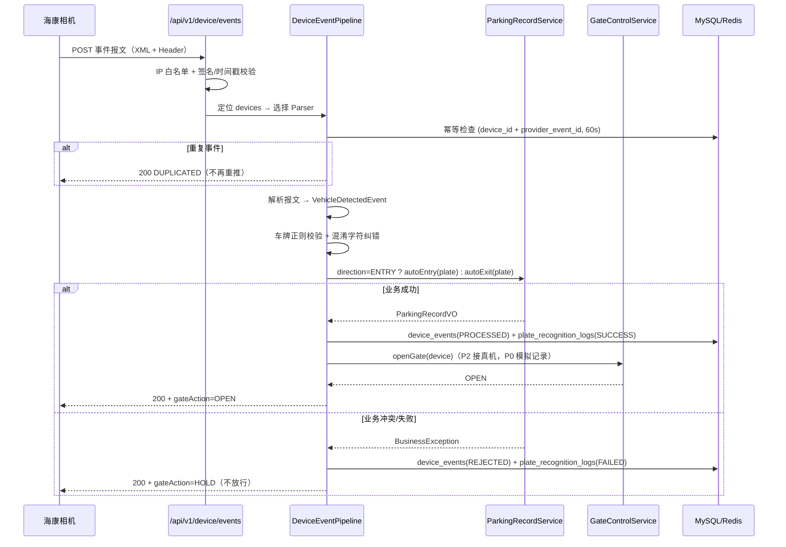

# 硬件接入设计：停车相机（海康 ISAPI）事件接入层

> 状态：设计文档（未实现）。本文档面向"接入海康威视等停车相机硬件"的目标，定义设备事件接入层的表结构、接口、适配器策略、安全模型与真机联调清单。
> 现有 OCR 通道（`Phase 2.8`）的定位调整与基础加固建议见第 12 节。

## 1. 背景与目标

当前系统的车辆识别是**服务端 OCR 模型**：管理员上传抓拍图片 → 后端调百度 OCR → 拿到车牌号 → 走 `autoEntry`/`autoExit`。该模型适合无硬件环境演示与移动端补录。

接入停车相机后，模型变为**设备端识别 + 事件推送**：

- 海康车牌识别相机（TCG/ITC 系列）内置识别算法，相机本地完成车牌识别、抓拍，输出车牌号、颜色、置信度、图片；
- 相机将识别结果主动 HTTP POST 到平台配置的回调地址（ISAPI 报警事件）；
- 服务端职责从"做识别"变为"接事件、做校验与业务处理、反馈放行结果、控制道闸"。

目标：新建**设备事件接入层**，让"车牌来源"可插拔（相机事件 / 服务端 OCR / 模拟数据），识别之后的业务管线完全复用现有代码。

## 2. 两种通道的对比

| 维度 | 现有 OCR 通道 | 硬件事件通道（本设计） |
| --- | --- | --- |
| 识别执行方 | 服务端调百度 OCR | 相机内置算法 |
| 触发方式 | 管理员上传图片 | 相机识别到车辆主动推送 |
| 端点认证 | JWT（管理员） | 免 JWT：IP 白名单 + 设备凭证 |
| 车牌来源 | `PlateRecognitionService.recognize(bytes)` | `DeviceEventParser` 解析事件报文 |
| 业务管线 | `ParkingRecordService.autoEntry/autoExit` | **同左，完全复用** |
| 道闸控制 | 无 | `GateControlService` 抽象（本设计预留） |
| 幂等要求 | 低（人工触发） | 高（设备可能重推事件） |

## 3. 总体架构

```
                     ┌──────────────────────────────────────────────────┐
                     │                    后端 (8080)                    │
                     │                                                  │
海康相机 x N          │  ┌────────────┐   ┌──────────────────────────┐   │
┌──────────┐  ISAPI  │  │ 设备回调端点 │   │  事件处理管线             │   │
│ 入口相机  │────────▶│  │ /device/   │──▶│  1. IP 白名单+凭证校验    │   │
│ 出口相机  │  事件推送 │  │ events     │   │  2. 幂等去重(device_events)│  │
└──────────┘         │  └────────────┘   │  3. DeviceEventParser 解析│   │
                     │        ▲          │  4. 车牌格式校验+纠错      │   │
                     │        │          │  5. autoEntry / autoExit  │──┼──▶ 业务库
模拟相机/联调工具      │  ┌─────┴──────┐   │  6. plate_recognition_logs│   │
┌──────────┐  JSON   │  │ 设备管理接口 │   │  7. 放行决策 + 道闸控制    │   │
│ 联调脚本  │────────▶│  │ (管理员JWT) │   └──────────────────────────┘   │
└──────────┘         │  └────────────┘             │                     │
                     │                     GateControlService             │
百度 OCR（保留）       │                     ├─ 模拟实现（记录日志）          │
（人工补录通道）        │                     └─ 海康 IO 触发实现（P2 真机联调）│
                     └──────────────────────────────────────────────────┘
```

车牌来源可插拔：`HIKVISION_ISAPI`、`GENERIC_JSON`、`SIMULATION`、`BAIDU_OCR` 四种 provider，前三种走设备事件层，`BAIDU_OCR` 保留现有上传识别接口。

## 4. 网络与部署前提

1. 相机与后端在同一局域网（或路由可达），相机可访问后端 `8080` 端口；docker-compose 部署时 `BACKEND_PORT` 已映射，无需改动。
2. 后端回调端点为**免 JWT 端点**（设备无法持有用户凭证），安全依赖 IP 白名单 + 设备凭证（见第 9 节）。
3. 相机侧需要开启"事件上报/报警主机"功能并配置后端回调地址（见第 13 节联调清单）。
4. 后端调用相机 ISAPI（道闸控制、抓拍图拉取）需支持 **HTTP Digest 认证**（海康设备标准认证方式；Spring RestClient 需搭配 Apache HttpClient 5 的 `DigestScheme`，实现阶段引入 `httpclient5` 依赖）。

## 5. 数据库设计

### 5.1 devices（设备注册表）

```sql
CREATE TABLE IF NOT EXISTS devices (
  device_id BIGINT PRIMARY KEY,
  device_code VARCHAR(64) NOT NULL,              -- 平台内唯一编码，如 ENTRY-GATE-01
  name VARCHAR(64) NOT NULL,
  vendor VARCHAR(30) NOT NULL,                   -- HIKVISION / GENERIC / SIMULATION
  model VARCHAR(64) NULL,                        -- 型号，如 DS-TCG225
  ip_address VARCHAR(45) NOT NULL,               -- 设备 IP（白名单 + 定位设备用）
  channel_no INT NOT NULL DEFAULT 1,             -- ISAPI 通道号
  direction VARCHAR(10) NOT NULL,                -- ENTRY / EXIT
  lane_no INT NULL,                              -- 车道号（多车道场景）
  bound_area VARCHAR(50) NULL,                   -- 绑定区域（可选，联动车位推荐）
  isapi_username VARCHAR(64) NULL,               -- 平台调设备 ISAPI 的凭证（道闸控制/拉图）
  isapi_password VARCHAR(128) NULL,              -- 建议加密存储
  secret_key VARCHAR(128) NOT NULL,              -- 事件推送校验凭证（HMAC 签名或 Basic）
  enabled TINYINT NOT NULL DEFAULT 1,
  last_online_time DATETIME NULL,                -- 最近收到事件时间（健康检查）
  create_time DATETIME NOT NULL,
  update_time DATETIME NOT NULL,
  UNIQUE KEY uk_devices_code (device_code),
  KEY idx_devices_ip (ip_address),
  KEY idx_devices_direction (direction)
) ENGINE=InnoDB DEFAULT CHARSET=utf8mb4 COLLATE=utf8mb4_unicode_ci;
```

外键关系：`devices` 不被其他表外键引用，`device_events.device_id` 逻辑关联（设备删除不影响事件审计），无外键约束。

### 5.2 device_events（设备事件表）

```sql
CREATE TABLE IF NOT EXISTS device_events (
  event_id BIGINT PRIMARY KEY,
  device_id BIGINT NOT NULL,                     -- 逻辑关联 devices
  raw_content MEDIUMTEXT NOT NULL,               -- 原始报文（XML/JSON 全文，审计与排障）
  plate_number VARCHAR(20) NULL,                 -- 解析结果
  plate_color VARCHAR(30) NULL,
  confidence DECIMAL(5,4) NULL,
  snapshot_url VARCHAR(255) NULL,                -- 抓拍图地址（落盘后路径或相机 URL）
  provider_event_id VARCHAR(128) NULL,           -- 设备侧事件/抓拍 ID，用于幂等
  process_status VARCHAR(20) NOT NULL,           -- PROCESSED / DUPLICATED / PARSE_FAILED / REJECTED
  process_error VARCHAR(500) NULL,               -- 处理失败原因
  record_id BIGINT NULL,                         -- 关联 parking_records.record_id
  plate_log_id BIGINT NULL,                      -- 关联 plate_recognition_logs.id
  gate_action VARCHAR(20) NULL,                  -- OPEN / HOLD（放行决策，P2 使用）
  event_time DATETIME NOT NULL,                  -- 事件发生时间（设备时间，解析失败用接收时间）
  receive_time DATETIME NOT NULL,
  create_time DATETIME NOT NULL,
  KEY idx_device_events_device_id (device_id),
  KEY idx_device_events_plate_number (plate_number),
  KEY idx_device_events_process_status (process_status),
  KEY idx_device_events_event_time (event_time),
  KEY idx_device_events_provider_event (device_id, provider_event_id)
) ENGINE=InnoDB DEFAULT CHARSET=utf8mb4 COLLATE=utf8mb4_unicode_ci;
```

幂等说明：`uk` 级唯一约束不用 DB 层（设备侧 event id 生成规则各厂商不一，且重推窗口短），采用**应用层去重**：按 `(device_id, provider_event_id)` 查 60 秒内同键已处理事件则标记 `DUPLICATED` 直接返回成功（让设备停止重推）。若真机联调确认存在高频重推，可再升级为 DB 唯一键 + `DUPLICATED` 状态。

### 5.3 plate_recognition_logs 复用

硬件通道的识别结果继续写 `plate_recognition_logs`：

- `provider` = `HIKVISION` / `GENERIC` / `SIMULATION`（现值 `BAIDU`）；
- `camera_type` 复用 `ENTRY` / `EXIT`（`RecognitionCameraType` 现有枚举），`UPLOAD` 仍为 OCR 通道专用；
- `confidence` 存相机上报的置信度（海康为 0-100 整数，统一换算为 0-1 小数）。

## 6. 接口设计

### 6.1 设备事件回调（设备侧，免 JWT）

```text
POST /api/v1/device/events
Content-Type: application/xml | application/json | multipart/mixed
X-Device-Code: ENTRY-GATE-01
X-Device-Timestamp: 1728291000000
X-Device-Sign: HMAC-SHA256(deviceCode + timestamp + body, secretKey)
```

| 参数 | 位置 | 必填 | 说明 |
| --- | --- | --- | --- |
| 报文体 | body | 是 | 相机原始事件报文（XML/JSON），由适配器解析 |
| `X-Device-Code` | header | 是 | 设备编码，定位 `devices` 记录 |
| `X-Device-Timestamp` | header | 是 | 毫秒时间戳，超出 ±5 分钟窗口拒绝（防重放） |
| `X-Device-Sign` | header | 是 | HMAC 签名，密钥为 `devices.secret_key` |

返回：

```json
{ "code": 200, "message": "success", "data": { "eventId": 123, "processStatus": "PROCESSED", "gateAction": "OPEN" } }
```

设计要点：

- 即使业务处理失败（如车辆未登记、车位已满），只要报文合法就返回 200——设备重推解决不了业务问题，反复重推只会浪费配额；处理失败记录在 `device_events.process_status` 由平台侧跟进。仅鉴权失败、签名错误、解析失败返回 4xx。
- 海康部分固件不支持自定义 Header。兼容方案（真机联调时二选一）：`secret_key` 作为 Basic Auth 密码（`Authorization: Basic base64(deviceCode:secretKey)`），或纯 IP 白名单模式（`devices.secret_key` 置空）。实现时三种校验策略共存，按设备记录配置。
- 响应体格式对设备无意义（海康只看 HTTP 状态码），统一 `ApiResponse` 即可。

### 6.2 设备管理接口（管理员，JWT）

按现有模块规范（DTO/VO/Convert/@PreAuthorize/@Valid/Swagger）：

| 方法 | 路径 | 权限 | 说明 |
| --- | --- | --- | --- |
| POST | `/api/v1/admin/devices` | `hasRole('ADMIN')` | 新增设备（编码、厂商、IP、方向、凭证） |
| PUT | `/api/v1/admin/devices/{deviceId}` | `hasRole('ADMIN')` | 修改设备信息/凭证/启停 |
| DELETE | `/api/v1/admin/devices/{deviceId}` | `hasRole('ADMIN')` | 删除设备（有事件引用时 409，逻辑同车辆删除） |
| GET | `/api/v1/admin/devices/{deviceId}` | `hasRole('ADMIN')` | 设备详情 |
| GET | `/api/v1/admin/devices` | `hasRole('ADMIN')` | 分页查询（厂商/方向/启停筛选） |
| GET | `/api/v1/admin/device-events` | `hasRole('ADMIN')` | 分页查询事件（设备/车牌/处理状态/时间区间筛选） |

## 7. 适配器策略模式设计

```java
/** 设备事件解析器：厂商报文 → 统一事件模型 */
public interface DeviceEventParser {

    /** 该解析器支持的厂商标识（对应 devices.vendor） */
    String vendor();

    boolean supports(String contentType, String body);

    /** 解析失败抛 DeviceEventParseException（携带错误码），由管线记录 PARSE_FAILED */
    VehicleDetectedEvent parse(DeviceDeviceContext context, String body) throws DeviceEventParseException;
}

/** 统一事件模型 */
public record VehicleDetectedEvent(
        String plateNumber,          // 原始识别车牌
        String plateColor,
        BigDecimal confidence,       // 统一换算为 0-1
        String providerEventId,      // 设备侧事件/抓拍 ID（幂等键）
        LocalDateTime eventTime,
        String snapshotBase64,       // 事件内嵌抓拍图（可空，海康多为 URL 引用）
        String snapshotUrl           // 相机侧图片地址（可空，Digest 拉取）
) { }
```

实现清单：

| 实现 | vendor | 说明 |
| --- | --- | --- |
| `HikvisionIsapiEventParser` | `HIKVISION` | 解析 ISAPI `EventNotificationAlert` XML（见第 8 节报文样例）；multipart/mixed 报文先分离 XML part 与 JPEG part |
| `GenericJsonEventParser` | `GENERIC` | 约定字段 `{plateNumber, plateColor, confidence, eventId, eventTime, snapshotBase64}`，供联调脚本/第三方设备使用 |
| `SimulationEventParser` | `SIMULATION` | 开发/演示用：按约定规则从报文或请求参数生成车牌（如 `?plate=粤B12345`），置信度固定 0.99，配合 Simulation 门控实现走通全流程 |

选择机制：回调处理时按 `X-Device-Code` 定位 `devices` 记录 → 取 `vendor` → 路由到对应 `DeviceEventParser`（Spring 注入 `List<DeviceEventParser>` 构建 Map）。新增厂商 = 新增一个 Parser Bean + devices.vendor 枚举值，不改管线代码。

## 8. 海康 ISAPI 事件报文样例

入口/出口相机会在 Web 端配置"事件上传"后，把识别事件 POST 到回调地址。典型 XML 形态（`EventNotificationAlert`，海康 ver20 XMLSchema）：

```xml
<EventNotificationAlert version="2.0" xmlns="http://www.hikvision.com/ver20/XMLSchema">
  <ipAddress>192.168.1.64</ipAddress>
  <portNo>80</portNo>
  <dateTime>2026-10-07T15:30:00+08:00</dateTime>
  <eventDescription>licensePlateDetection</eventDescription>
  <eventState>active</eventState>
  <event_type>ANPR</event_type>
  <LicensePlateDetectionList>
    <LicensePlateDetection>
      <notificationIdentification>20261007153000123</notificationIdentification>
      <SourceIdentification>
        <channelID>1</channelID>
      </SourceIdentification>
      <licensePlateInfo>
        <licensePlate>
          <licensePlateNumber>粤B12345</licensePlateNumber>
          <licensePlateColor>blue</licensePlateColor>
          <confidenceLevel>95</confidenceLevel>
          <licensePlateType>normal</licensePlateType>
        </licensePlate>
        <vehicleInfo>
          <vehicleType>sedan</vehicleType>
        </vehicleInfo>
      </licensePlateInfo>
    </LicensePlateDetection>
  </LicensePlateDetectionList>
</EventNotificationAlert>
```

解析映射：

| 报文字段 | 统一事件模型 | 说明 |
| --- | --- | --- |
| `LicensePlateDetection/licensePlateInfo/licensePlate/licensePlateNumber` | `plateNumber` | 车牌号 |
| `licensePlateInfo/licensePlate/licensePlateColor` | `plateColor` | blue/yellow/green/white/black（新能源为 green） |
| `licensePlateInfo/licensePlate/confidenceLevel` | `confidence` | 0-100，换算 0-1 |
| `notificationIdentification` | `providerEventId` | 幂等键；缺省时用 `ipAddress+dateTime` 兜底 |
| `dateTime` | `eventTime` | 设备时间 |
| 抓拍图 | `snapshotUrl` / `snapshotBase64` | 因固件而异：事件内嵌 base64、multipart JPEG part、或 `pictureURL` 需 Digest 拉取 |

> ⚠️ 以上字段名为海康 ISAPI 典型格式，具体节点名与抓拍图携带方式随型号/固件版本有差异（部分型号走 multipart/mixed、部分走 JSON、部分图片仅存设备端 SD 卡）。真机联调时先抓取真实报文核对，必要时在本表上微调映射即可——适配器隔离了这些差异，管线代码不受影响。

## 9. 事件处理流程与安全

### 9.1 处理时序



### 9.2 安全设计

1. **端点放行**：`SecurityConfig` 中 `requestMatchers(HttpMethod.POST, "/api/v1/device/events").permitAll()`，与 auth 公开端点同级；鉴权由设备过滤器完成（新增 `DeviceAuthFilter` 或在管线内第一步实现）。
2. **IP 白名单**：请求来源 IP 必须与 `devices.ip_address` 匹配（可配 CIDR 段，实现按需）。未注册 IP 直接 401，不进入业务。
3. **凭证校验**三选一（按设备配置）：HMAC 签名（首选）、Basic Auth（海康老固件兼容）、免凭证（仅白名单，内网部署用）。
4. **防重放**：`X-Device-Timestamp` 超出 ±5 分钟拒绝；HMAC 覆盖 body 防篡改。
5. **原始报文留存**：`device_events.raw_content` 全文保存，安全审计与解析排障依据。
6. **速率保护**：回调端点复用 Redis 固定窗口限流（同 `LoginRateLimiter` 模式，按设备维度，如 60 次/分钟），防止异常设备刷爆处理管线。

### 9.3 异常与幂等

| 场景 | 处理 | device_events 状态 |
| --- | --- | --- |
| 同事件 60s 内重推 | 直接返回 200，不重复处理 | `DUPLICATED` |
| 报文解析失败（未知格式/缺字段） | 返回 400 + 错误码，保留原始报文 | `PARSE_FAILED` |
| 车牌格式校验失败（正则不匹配且纠错无效） | 返回 200，记录告警 | `REJECTED` |
| 业务冲突（车辆未登记、车位满、重复入场、预约过期等） | 返回 200（`gateAction=HOLD`），错误信息落库 | `REJECTED` |
| 处理成功 | — | `PROCESSED` |

## 10. 道闸控制抽象

```java
/** 道闸控制：P0 仅模拟实现，P2 真机联调时补海康实现 */
public interface GateControlService {

    /**
     * @return 放行动作（OPEN 抬杆 / HOLD 不放行）
     */
    String control(Device device, VehicleDetectedEvent event, boolean allowPass);
}

/** 模拟实现：记录日志，返回 OPEN/ */
/** 海康实现（P2）：调用相机 ISAPI 触发报警输出驱动道闸
 *  典型指令：PUT http://{deviceIp}/ISAPI/System/IO/outputs/{outputId}/trigger
 *  部分型号支持道闸专用指令（/ISAPI/Traffic/channels/{ch}/barrierGates/...）
 *  ⚠️ 具体 URI 与报文以真机固件的 ISAPI 文档为准，需真机核对后实现
 */
```

设计约束：

- 道闸调用失败**不影响**事件处理结果落库（闸机故障时记录照常生成，`gate_action` 置空并告警）；
- 放行决策在平台侧（`allowPass` = 业务处理成功），相机本地白名单模式（相机自己判断抬杆）作为无平台场景的降级，联调清单中说明两者互斥配置。

## 11. 与现有代码的对接点

| 现有组件 | 复用方式 |
| --- | --- |
| `ParkingRecordService.autoEntry(plate, preferredSpaceId)` / `autoExit(plate)` | 事件管线直接调用，业务闭环（车位 CAS、预约校验、费用计算）零改动 |
| `plate_recognition_logs` 表 + `RecognitionCameraType` 枚举 | 硬件识别结果继续落此表，`camera_type` 复用 ENTRY/EXIT，`provider` 扩展新值 |
| `GlobalExceptionHandler` | 管线业务异常已有统一处理；新增 `DeviceEventParseException` 处理 |
| 车牌格式校验（本次新增，OCR 通道同样需要） | 提取公共 `PlateNumberValidator`（大陆车牌正则 + O/0、I/1 混淆纠错），OCR 结果与设备事件共用 |
| `JwtAuthenticationFilter` / `SecurityConfig` | 新增设备端点放行规则与设备鉴权组件，互不干扰 |

## 12. OCR 通道定位调整与基础加固

硬件接入后，服务端 OCR 通道保留为**无硬件环境的人工补录/移动端拍照**能力。建议随设备模块一并加固（上轮审查结论，两个通道共同受益）：

1. 识别结果车牌正则校验 + 混淆字符纠错（`PlateNumberValidator`）；
2. `RecognitionConfig` 的 RestClient 增加连接/读取超时（配置化，参照 AI 模块 `timeout-seconds`）；
3. `spring.servlet.multipart` 上传大小限制（默认 1MB 会拒真实相机照片）+ `MaxUploadSizeExceededException` 全局处理返回 400；
4. 上传文件类型校验（JPEG/PNG 白名单）；
5. `BaiduOcrClient` 调用耗时与失败日志；
6. `Simulation` provider 兼作 OCR 通道的无密钥演示模式。

## 13. 真机联调清单（P1）

前置：相机（如 DS-TCG225 或 ITC 系列）已上电、接入内网、Web 管理可访问。

1. **采集信息**：相机 IP、通道号、固件版本、ISAPI 文档版本；
2. **相机侧配置**：网络 → 高级配置 → 集成协议/事件上传：启用事件上报，服务器地址填后端 `http://{backend}:8080/api/v1/device/events`，协议按固件选 ISAPI/HTTP 监听，配置认证凭证；
3. **抓取真实报文**：先用抓包/临时 echo 服务采集 2-3 个真实事件（入场、出场、新能源车牌），核对第 8 节字段映射与抓拍图携带方式；
4. **验证鉴权方式**：确认设备支持自定义 Header / Basic / 仅白名单，确定该型号可用的校验策略；
5. **平台侧验证**：设备注册 → 事件接收 → 幂等重推测试（同事件重复推送）→ 业务闭环（已登记车辆入场出场、未登记车辆 HOLD）；
6. **道闸联调（P2）**：确认道闸由相机 IO 输出还是独立控制器驱动，抓取 ISAPI 触发指令报文，实现并验证 `GateControlService` 海康实现；
7. **验收用例**：正常入出场、重复入场事件、未登记车辆、断网重连后事件重推、时间戳过期拒绝、白名单外 IP 拒绝。

## 14. 实施阶段建议

| 阶段 | 内容 | 依赖 |
| --- | --- | --- |
| P0 地基 | devices/device_events 表、设备管理接口、回调端点 + 三种 Parser + 幂等 + 安全、`PlateNumberValidator`、OCR 基础加固（第 12 节）、Simulation 全流程演示、单元测试 | 无，可立即开发 |
| P1 真机联调 | 抓真实报文核对 `HikvisionIsapiEventParser` 字段映射、鉴权策略落地、Digest 客户端（httpclient5） | 需相机在手 |
| P2 道闸联动 | `GateControlService` 海康 IO 实现、放行决策联动、故障告警 | P1 完成 |

P0 完成后无需真机即可用 `GenericJsonEventParser` / `SimulationEventParser` 走通"事件 → 业务 → 日志"全流程并联调前端设备管理页面。
